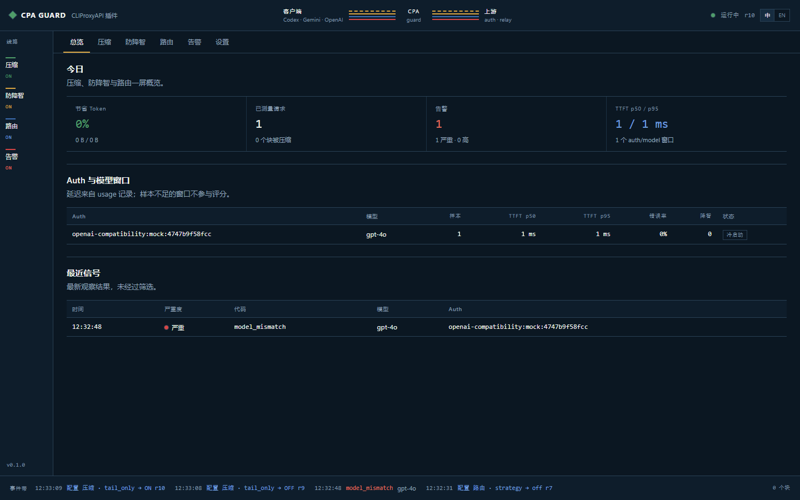

# RelayWarden

[中文](README_CN.md) | English

A CLIProxyAPI v8 plugin for three jobs on the relay path:

1. **Token compression** — rewrite tool output before it leaves the gateway.
2. **Relay degradation signals** — observe model substitution, stripped reasoning, cache loss, and parameter drops.
3. **Latency-aware routing** — keep a session on the same auth for prompt-cache affinity, and prefer the fastest healthy auth when samples exist.

RelayWarden is a plugin, not another gateway. It loads into CLIProxyAPI as a C ABI dynamic library, and the management UI is embedded in the same DLL.



## Status

v0.1, Windows-tested end to end. Linux and macOS c-shared builds are covered by CI but have not been tested against a live CLIProxyAPI instance in this repository. Degradation handling is **observe-only**: signals are recorded, routing is not switched, and responses are not edited.

## Features

### Compression

- Source formats: OpenAI Chat Completions, OpenAI Responses / Codex, Gemini.
- Tool-output shapes: `role: "tool"`, `function_call_output`, `custom_tool_call_output`, `local_shell_call_output`, Gemini `functionResponse.response`.
- 14 filters: git diff/status/log, grep, find, ls, tree, build output, test output, log dedup, smart truncate, numbered file dumps, JSON minify, ANSI cleanup.
- `tail_only` by default: only tool output after the last user turn is touched, so the prompt-cache prefix stays byte-stable.
- `shadow: true` by default: measure savings without changing what is sent.
- Every path fails open. A replacement must be non-empty, strictly smaller, and must not lose error lines.

### Guard signals

- `model_mismatch`
- `reasoning_stripped`
- `source_param_dropped`
- `cache_miss_streak`
- `cache_miss_reason`
- `service_tier_downgraded`
- `system_fingerprint_changed`
- `usage_invariant_violation`
- `tools_changed`
- `system_prompt_changed`
- `empty_output`
- `truncated`
- `usage_missing`
- `ttft_anomaly`

Each signal has its own switch. Signals can be written to the CPA log and/or sent to an HTTP webhook. Webhook delivery is asynchronous, bounded, and never blocks a request.

### Routing

- Per `auth + model` rolling windows: 20 samples, 15-minute TTL, 3 samples before scoring.
- Score: `0.60 * norm(TTFT) + 0.25 * error_rate + 0.15 * degrade_rate`.
- Session affinity keeps a session on its previous auth unless it is clearly slower.
- If no candidate has enough samples, RelayWarden returns `Handled: false` and CPA's built-in scheduler keeps control.

## How it plugs into CLIProxyAPI

| Hook | Use |
|---|---|
| `request.intercept_before` | Save the request profile; compress tool output; optionally derive a prompt-cache key. |
| `request.intercept_after` | Restore source-level fields lost before translation. The body is still source JSON; provider translation happens later in the executor. |
| `response.intercept_after` | Inspect non-stream responses for truncation, empty output, fingerprints, and cache diagnostics. |
| `usage.handle` | Model identity, reasoning/cache/usage invariants, TTFT samples, routing windows. |
| `scheduler.pick` | Cache-affinity and latency-aware auth selection. |
| `management_api` | Status, compression stats, preview, signals, usage diagnostics, routing windows, and the embedded UI. |

No stream-chunk interceptor is registered. Streaming requests rely on the final `usage.handle` record.

## Install

### From the plugin store

RelayWarden is submitted to the official CLIProxyAPI plugin store. Once listed, install it from the CPA management panel: CPA downloads the archive for your platform, verifies it against `checksums.txt`, and writes it to `plugins/<goos>/<goarch>/`.

### Manual

Download `relaywarden.<ext>` from the [latest release](https://github.com/Kyresn/relaywarden/releases/latest) and place it in CLIProxyAPI's plugin directory.

```yaml
plugins:
  enabled: true
  dir: "plugins"          # the file name must match the config key
  configs:
    relaywarden:
      enabled: true
      priority: 10
      compression:
        enabled: true
        shadow: true       # measure first
      guard:
        enabled: true
      routing:
        enabled: true
```

The full switch surface is in [config.example.yaml](config.example.yaml). Restart CPA after adding the plugin.

## Management UI

Open:

```text
http://127.0.0.1:8317/v0/resource/plugins/relaywarden/ui
```

No trailing slash. Enter the CPA management key on first load. The key is kept in `sessionStorage` only; the page itself is static and contains no runtime data. All API calls use `Authorization: Bearer <management-key>`.

The UI supports Chinese and English (top-right `中 / EN`), reads effective config from the plugin, and writes switches through CPA v8:

```text
PATCH /v8/management/config/plugins/configs/relaywarden
```

CPA persists the change to `config.yaml` and calls `plugin.reconfigure`; the UI polls `config_revision` until the new snapshot is active.

## Management API

All plugin routes require the CPA management key.

| Method | Path | Purpose |
|---|---|---|
| GET | `/v0/management/relaywarden/status` | Version, config revision, counters, effective switches |
| GET | `/v0/management/relaywarden/config` | Effective config with defaults |
| GET | `/v0/management/relaywarden/compression/stats` | Counters by filter, model, format |
| POST | `/v0/management/relaywarden/compression/preview` | `{"text":"...","format":"openai-response"}` |
| GET | `/v0/management/relaywarden/signals?limit=100` | Recent signals |
| GET | `/v0/management/relaywarden/signals/summary` | Counters by signal code |
| GET | `/v0/management/relaywarden/usage` | Recent usage records for diagnostics |
| GET | `/v0/management/relaywarden/routing` | Per-auth/model latency windows |

## Build

Requirements: Go 1.26+, Node 20+, and a C toolchain for cgo (`mingw-w64` on Windows, gcc/clang on Linux/macOS).

```bash
npm --prefix web ci
npm --prefix web run build
CGO_ENABLED=1 go build -buildmode=c-shared -o plugins/relaywarden.dll .
```

On Linux/macOS:

```bash
CGO_ENABLED=1 go build -buildmode=c-shared -o plugins/relaywarden.so .
# macOS: relaywarden.dylib
```

`web/dist` must exist before the Go build because the UI is embedded with `go:embed`.

## Test

```bash
go test ./...
go test -race ./...
go vet ./...
npm --prefix web run build
```

Compression benchmarks:

```bash
go test ./internal/compress -run '^$' -bench . -benchtime=2s
```

On a Ryzen 7 9800X3D, filter-only measurements are ~2.4 ms per 100 KB grep output and ~0.06 ms per 100 KB git diff. These exclude C ABI body encoding and host JSON costs.

## Local end-to-end

`testdata/` contains a local CPA config, a mock OpenAI-compatible upstream, and sample requests. They use dummy keys only.

```bash
node testdata/mock-upstream.mjs
cpa-server -config testdata/relaywarden-config.yaml
curl -H "Authorization: Bearer test-client-key" \
  -H "Content-Type: application/json" \
  --data-binary @testdata/request.json \
  http://127.0.0.1:18317/v1/chat/completions
```

## Known limits

- Claude/Anthropic client protocols are not covered.
- No LLMLingua prompt compression. Caveman and ponytail are behaviour prompts appended to the system text (`caveman.level` / `ponytail.level`, default `off`); they shorten answers, not input.
- No per-chunk stream integrity checks.
- No automatic fallback, retry, or hedging.
- Cannot see what a relay changes after the request leaves CPA; only observable signals are recorded.
- Routing is observe + select; it never edits a response.
- The management UI targets a local single operator; it does not implement multi-user permissions, audit logs, or remote shared deployment.

## Security

- Management key: `sessionStorage` only, never written to disk or logs.
- UI preferences: `localStorage` for language and last config change; no secrets.
- CSP on the embedded page: `default-src 'self'; connect-src 'self'; frame-ancestors 'self'`. The panel embeds the page in a same-origin iframe; cross-origin framing is blocked.
- No external fonts, analytics, or CDN assets.
- Webhook URLs must be absolute `http(s)`; delivery is asynchronous and best-effort.
- Plugin optional paths fail open; only registration/config parse errors block loading.

## Documentation

- [Compression research](docs/COMPRESSION_RESEARCH.md)
- [Architecture](docs/ARCHITECTURE.md)
- [Management UI](docs/UI.md)
- [Product context](PRODUCT.md)
- [Design system](DESIGN.md)
- [Domain glossary](CONTEXT.md)
- [ADRs](docs/adr/)

## License

MIT. See [LICENSE](LICENSE).
