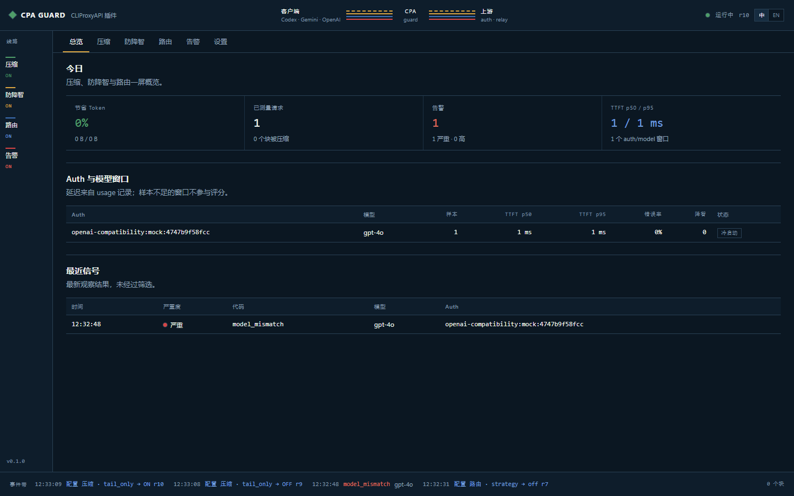
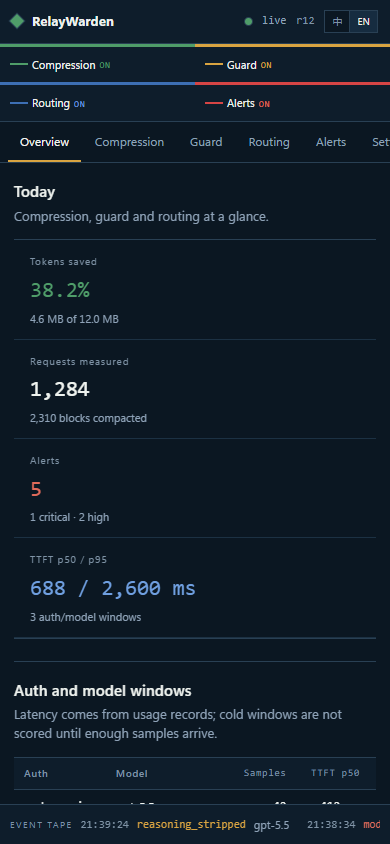
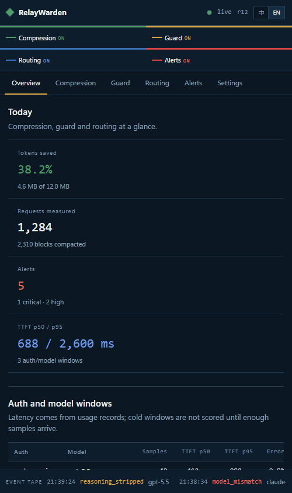
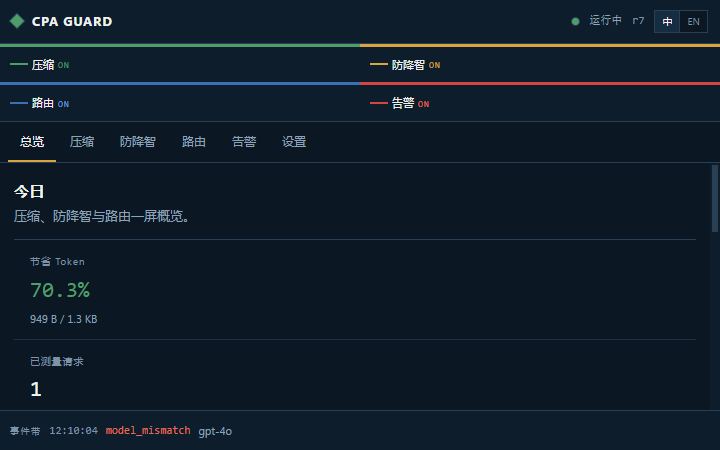
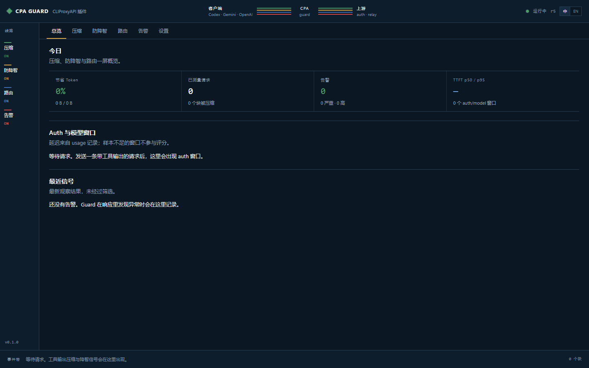
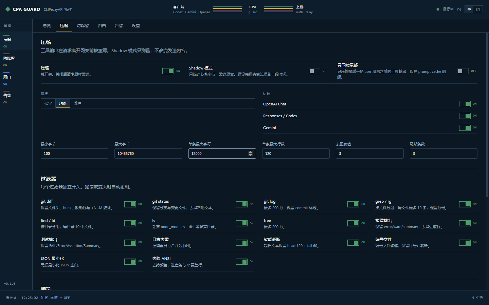

# Management UI

Screenshots use synthetic mock data; they are not production evidence.

## Direction contract

THESIS
A gateway console read as a transit diagram: feature lines, auth stations, and
service states. It refuses the same-size card grid and the hero-metric template.

OWN-WORLD
Midnight enamel ground, porcelain text, hairline rules, and four line inks:
green (compression), amber (guard), cobalt (routing), red (alerts). Segoe UI
Variable carries the interface; Cascadia Mono carries numbers, IDs, and logs.
Controls are standard web controls; the world enters only through type, palette,
density, and the route strip.

STORY
The operator sees which protection is active, which auth is delayed, and what
changed last, then flips the relevant line without editing YAML.

FIRST VIEWPORT
Top bar: brand, Client -> CPA -> Upstream route strip with four parallel lines,
live indicator, config revision, language switch. Left: line rail with four
status lines; master switches live on their pages. Main: tabs, readout row, auth table, recent signals. Bottom:
event tape.

FORM
Assigned direction 3 of the grounded list; seed reference:
`seed:a900d29114ca692c`.

FINISH
Unreviewed and undocumented is unfinished; this build ends with the finish
review, the verdict, DESIGN.md, and every shipping raster carrying its
provenance.

## Information architecture

| Page | Job |
|---|---|
| Overview | Today's savings, requests, alerts, TTFT, auth windows, recent signals |
| Compression | Master switch, mode, shadow, tail-only, protocols, 14 filters, thresholds, preview |
| Guard | Master switch, source reinjection, cache-key injection, 11 checks, 14 signal switches, alert log/webhook |
| Routing | Master switch, strategy, cache affinity, weights, windows, auth table |
| Alerts | Severity/code filters, expandable signal evidence |
| Settings | Key state, plugin version/revision, polling, export, boundaries |

## Switch coverage

Every feature is switchable:

- compression master, shadow, tail-only, mode, three protocols, 14 filters,
  thresholds;
- guard master, source reinjection, cache-key injection, 11 checks, 14 signals,
  alert log, webhook, severity threshold;
- routing master, strategy, cache affinity, weights and windows;
- metrics retention, UI polling, advanced values;
- plugin enabled at the host level.

Dangerous off-switches (compression, guard, routing) show an inline confirmation
row, not a modal.

## Language

Chinese and English are both first-class. The toggle lives in the top bar and the
key gate. Preference is stored in `localStorage` under `relaywarden-lang`; it is a
UI preference, not a secret. Technical identifiers (signal codes, auth IDs,
model IDs, filter names) stay verbatim in both languages.

## Accessibility

- Switches use `role="switch"` and `aria-checked`; Space/Enter work.
- Focus ring uses the amber token at 2px offset.
- State is always written as text (ON/OFF, Healthy/Watch/Degraded), not color
  alone.
- Body text contrast is at least 4.5:1 on the midnight ground.
- `prefers-reduced-motion` removes transitions.
- Tables scroll horizontally below 760px; the layout does not rely on hover.

## Verification

- Desktop 1440x900 and mobile 390x844 screenshots.
- Keyboard pass: tab through line rail, tabs, switches, tables, preview.
- Key gate: no data before a key; 401 clears the key.
- Toggle pass: compression tail-only, guard signal, routing affinity; verify
  PATCH and `config_revision` change.
- Language pass: every page in zh and en; no untranslated Chinese remains in en.
